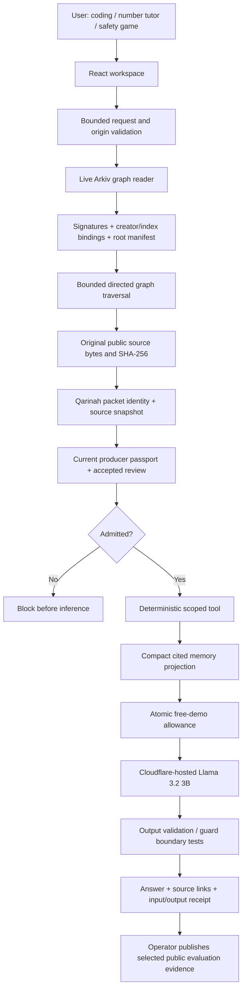

# Arkiv Graph: connected evidence and inspectable AI

Built by Ajnas NB. Live application: https://arkivgraph.ajnasnb.com. The original Qarinah repositories are preserved; this project integrates an Apache-2.0 licensed copy at the disclosed baseline in PREEXISTING.md.

## Reusable infrastructure and reference application

Arkiv Graph is the domain-neutral infrastructure SDK in `packages/arkiv-graph`. It owns signed nodes, edges, complete manifests, typed indexes, verified assembly and bounded traversal. Its packaged CLI exposes verify/trace commands and a stdio MCP server. The generic graph uses `arkiv-graph-v1`. Domain-specific node types and relationship names make it reusable outside AI.

AI Passport imports the shared engine through `packages/sdk/src/graph.ts`, preserving its existing graph namespace, record signatures and root. Qarinah context selection, passport review admission and hosted inference remain application layers. See [ARKIV_GRAPH.md](ARKIV_GRAPH.md) for installation and the isolated consumer reproduction across both profiles.

## The reference application

Three working tasks share one admission and evidence layer:

1. Coding handoff: a real hosted model generates a small release-guard specification. A deterministic interpreter tests six boundary cases and exports readable JavaScript. Arbitrary generated code is never executed.
2. India number tutor: exact paise calculation, Indian grouping, lakh/crore conversion, then a real AI explanation in English or Hindi.
3. UPI Safety Quest: a three-round playable educational game with immediate deterministic feedback and an optional AI coach. Public NPCI references support the project-authored learning summary. This is not a payment app or fraud-detection certification.

## Layered architecture



### 1. Capture and compilation

Qarinah compiles genuine packets from generated public/synthetic fixture repositories. Its original validator runs when fixtures are built. Selected decision events retain their original event IDs and hashes. Superseded context is excluded in the coding fixture.

Private operator memory never enters the demo. Public fixture packets are downloadable for reproduction. The Worker uses the SDK's browser-compatible packet identity validator and recomputes the selected repository digest from current public source bytes. The Node adapter additionally invokes Qarinah's original validator and reads real repository files with root-bound path checks.

### 2. Graph representation on Arkiv

Arkiv provides entities, indexed typed attributes, creators, lifetimes and queries. AI Passport supplies the graph contract and traversal. It does not claim native Cypher, server-side recursive joins, or a separate Solidity graph contract.

Node types: application, context, tool, source, model, review, decision and run. Edge relations: uses, compiled-from, reviewed-by, cites, derived-from, produced and supersedes. A tool-catalog reference uses `cites`; it is not falsely represented as a tool executed in every AI call.

Each node and edge is a separately signed immutable entity. A signed manifest lists every member ID and canonical content digest. The consumer pins the root graph digest, verifies accepted authorship, checks creator and indexed attributes against signed payloads, rejects missing/duplicate/extra members, then reconstructs the exact root. Source nodes contain original-source URLs and content digests. A source link alone never grants execution authority.

Queries use `namespace: str`, `schema_version: u64`, `graph_hash: bytes32`, `kind: str`, `node_id/node_type/from_id/to_id/relation: str` and live `$expiresAt`. Storage lasts 30 days; signed graph validity is 14 days. New revisions produce a new pinned root. Expired evidence must be renewed by the operator; no permanent-availability claim is made.

The SDK bounds a graph to 200 nodes/500 edges, eight query pages and traversal depth eight. A run uses depth four and at most forty selected nodes. A truncated traversal is rejected. These are tested MVP boundaries, not a large-scale benchmark.

### 3. Independent review and admission

Context and runtime passports use the existing `app-passport-v1` contract. Producers and reviewers sign separately. Both demonstration wallets are controlled by this project; they are not independent organizations or upstream endorsers. Admission requires exact artifact identity, the current source snapshot, accepted current review, and no applicable withdrawal.

Two consumers can choose different trusted reviewers over the same graph. This is where Arkiv adds value: shared, attributable, queryable evidence and current review/withdrawal state that another reader can obtain without this website's database. A conventional database remains sufficient for a single operator's calculator or chat application. Arkiv is not necessary for arithmetic or inference. Our SDK provides interoperability and authorship checks; it does not make factual claims true merely by publishing them.

### 4. Controlled tool execution and inference

The Worker chooses a fixed task from a strict request schema; clients cannot supply a provider URL, shell command, arbitrary prompt or filesystem path. The runtime performs arithmetic, quiz scoring or interpreted release-guard tests. The actual model is `@cf/meta/llama-3.2-3b-instruct` on Workers AI. The project cannot hash or attest hosted model weights, and explicitly reports this.

Selected event excerpts and source bodies are passed as untrusted data. The prompt is bounded to 10,000 memory characters and 420 output tokens. Approximate token counts use chars/4 and are labelled estimates. The UI compares selected-memory characters against full-packet characters; this is not a benchmark claiming exact token savings or improved model accuracy.

A SQLite Durable Object reserves at most forty model attempts per UTC day before inference. It stores only a count and deletes itself after a short retention period. A per-IP limiter allows three run requests per minute. No payment, plan upgrade or mainnet transaction is required by visitors. Public free quotas may run out; the calculator, game and graph remain usable.

### 5. Results and evidence

Successful receipts contain graph/context/runtime identities, the actual chain read blocks, selected event IDs, source content digests, model alias, bounded tool results and output. They also return the exact bounded evidence message passed to the model, its byte SHA-256, selected graph sizes and current admission results. The browser checks the evidence-message byte digest and canonical receipt digest before showing an admitted result. These are self-consistency checks of a project-generated report, not a zero-knowledge computation proof or a provider-signed inference certificate. Separate system/task instructions are not part of the exported evidence message.

Model output is plain text in the browser. Coding output must match a strict finite guard language, then pass six substantive tests; otherwise it is rejected. No generated code is passed to eval, Function, a shell, or an arbitrary remote tool.

Visitor receipts remain in the browser unless downloaded. Only operator-selected evaluations with public/synthetic inputs are added to public graph evidence. No account, PIN, private source document, personal chat, credential, or hash of personal data is published on Arkiv.

## Reproduction

```sh
npm ci --ignore-scripts
npm run build
npm run typecheck
npm test
npx tsx scripts/build-ai-fixtures.ts
npx tsx scripts/evaluate-ai.ts
```

Install the current public releases with `npm install @ajnasnb/arkiv-graph@0.4.0 @ajnasnb/ai-passport@0.6.0 qarinah@0.7.0`. From the checkout, `node scripts/consume-graph-infra.mjs --registry` installs them anonymously outside the workspace and checks both graph profiles, CLI commands and actual MCP requests. `node scripts/verify-backend-independence.mjs` additionally blocks all project API origins while reading the live graphs and withdrawn review through the public RPC. The exact queries and network trace are in `/data/backend-independence.json`.

For direct SDK usage, call `createGraphKit().readGraph({rpc,issuers}, graphDigest)` and `kit.traverseGraph(result.graph, start, {depth:4,maxNodes:40})`; use `AI_PASSPORT_PROFILE` for the reference application's preserved schema. Consumer-owned pinned policies and roots are in `/data/arkiv-graph-reader.json` and `/data/ai-passport-reader.json`. The raw Tiramisu RPC requires no website account; a provider may impose quota. A writer needs an accepted issuer wallet and free Tiramisu test tokens. Credentials remain outside the repository.

The immutable graph revisions include historical source snapshots, including the earlier 0.2.0 CLI. They prove the identity of those published snapshots, not of the current npm package. `/data/npm-release.json` separately binds the public 0.4.0/0.6.0 registry tarballs to the reviewed release bytes. Root and issuer discovery are explicit consumer policy; a new graph revision requires updating that pinned policy.

## Primary references

- Arkiv queries and typed attributes: https://docs.arkiv.network/json-rpc/querying-data/
- Arkiv JavaScript SDK: https://github.com/Arkiv-Network/arkiv-sdk-js
- Actual hosted model: https://developers.cloudflare.com/workers-ai/models/llama-3.2-3b-instruct/
- Workers AI free allocation: https://developers.cloudflare.com/workers-ai/platform/pricing/
- NPCI educational references: https://www.npci.org.in/fraud-awareness and https://www.npci.org.in/what-we-do/upi/faqs


## Authenticated root discovery and client history

The optional `/trust` package entry point adds a signed root registry, previous-revision links, finite current-head validity and persistent monotonic checkpoints. Registry discovery and complete graph reconstruction share one explicit block. The live root-update demo uses separately published tiny synthetic graphs; it leaves the AI reference graph pinned. Bootstrap authority/profile/policy are consumer settings. Authority or policy rotation requires explicit consumer approval. The reference two-client task retains verified withdrawal evidence under a per-client/session Web Lock before running a task.

See [trust setup](docs/TRUST_SETUP.md), [critical trust review](docs/TRUST_REVIEW.md), [19 measured safeguards](https://arkivgraph.ajnasnb.com/data/trust-safeguards.json) and [18 mobile lab audits](docs/MOBILE_PERFORMANCE.md). One RPC operator remains trusted for unseen history completeness. Local state can be cleared; no permanent network revocation or state-proof verification is claimed.
